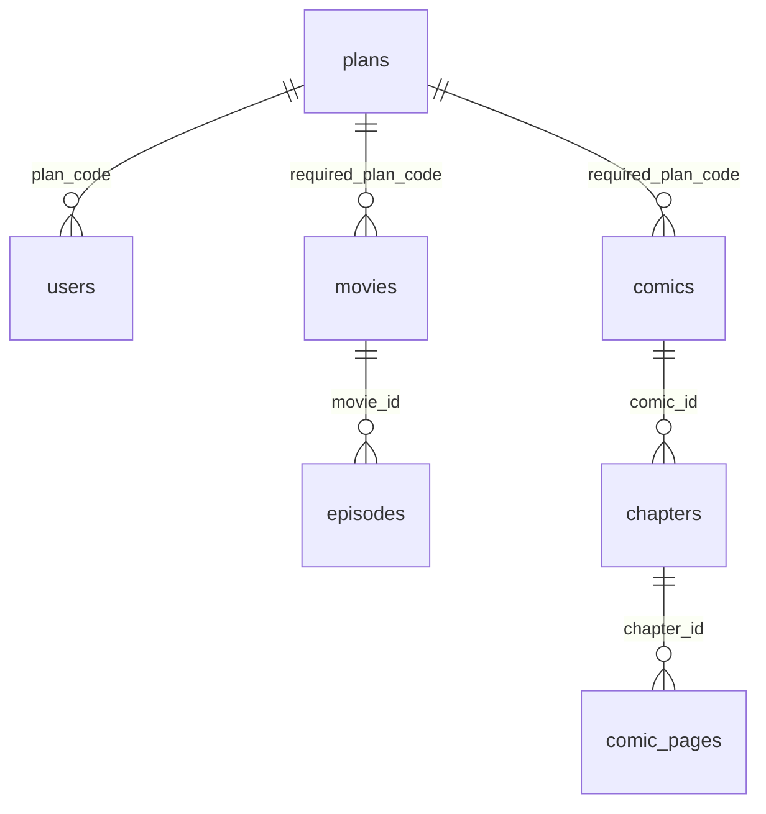

# Database — lịch sử giai đoạn 02, 03 và 05

Giai đoạn 05 bổ sung revision `0004_admin_catalogue`: genres, movie_genres,
audit_events; movies thêm poster_url/trailer_url/version, episodes thêm version.
Head hiện tại 0004; tổng 12 bảng ứng dụng + alembic_version. Genre FK RESTRICT khi
còn liên kết phim, movie FK CASCADE; audit giữ entity_id sau xóa và actor SET NULL
khi user bị xóa. Xem [ADMIN.md](ADMIN.md) về quyền runtime và rollback metadata.
Các đoạn giai đoạn 02/03 bên dưới mô tả lịch sử schema.

Giai đoạn 03 thêm revision `0003_auth`: `auth_sessions` (user FK, expires_at,
revoked_at) và `refresh_tokens` (hash PK, session FK, consumed_at); FK cascade
xóa token theo session/user. Tổng hiện tại 9 bảng ứng dụng, cộng alembic_version.
Rollback 0003 chỉ xóa hai bảng auth; bảo toàn users và catalogue, đã kiểm thử
trên database riêng. Runtime hiện được đọc users, INSERT các cột đăng ký,
đọc/tạo session/token, UPDATE revoked_at/consumed_at; không được sửa role/plan.
Chi tiết ở [AUTH.md](AUTH.md). Phần bên dưới ghi thiết kế tại giai đoạn 02.

PostgreSQL 17, SQLAlchemy 2 typed models, Alembic. Schema nghiệp vụ gồm 7 bảng;
`alembic_version` là bảng quản trị thứ 8. Không tạo bảng bằng `create_all()` khi API
khởi động. Mọi thay đổi schema đi qua revision bất biến.



| Bảng | Khóa và ràng buộc đáng chú ý |
|---|---|
| plans | PK code free/vip/premium; giá VND số nguyên; thời hạn/số thiết bị nullable khi nháp; không bán nếu thiếu giá/quyền lợi |
| users | UUID; email chuẩn hóa lowercase/trim và unique; role user/admin; default user + Free; password_hash bắt buộc có prefix Argon2id |
| movies | UUID; slug unique ASCII; title không rỗng; status draft mặc định; FK plan RESTRICT; index status/created_at và FK |
| episodes | UUID; FK movie CASCADE; unique movie/season/episode; số thứ tự và thời lượng dương |
| comics | UUID; slug unique; status draft; FK plan RESTRICT; index status/created_at và FK |
| chapters | UUID; FK comic CASCADE; unique comic/chapter_number; số thứ tự dương |
| comic_pages | UUID; FK chapter CASCADE; unique chapter/page_number có thể defer trong transaction; storage_key unique; width/height dương |

UUID có default ở Python và database. Tất cả bảng có `timestamptz` cho created_at/
updated_at. Trigger cập nhật updated_at cho cả ORM và SQL trực tiếp, giữ nguyên
created_at khi UPDATE. Các unique index composite bắt đầu bằng FK cũng phục vụ
truy vấn con theo cha; không tạo thêm index trùng lặp.

## Dữ liệu seed đã được người dùng chọn

| Code | Tên | Giá VND | Thời hạn / thiết bị | Active | Được bán |
|---|---|---:|---|---|---|
| free | Free | 0 | Chưa cấu hình | Có | Không |
| vip | VIP | NULL | Chưa cấu hình | Không | Không |
| premium | Premium | NULL | Chưa cấu hình | Không | Không |

NULL nghĩa là **chưa quyết định**, không phải miễn phí hoặc vô hạn. Payment/device
entitlement ở các giai đoạn sau phải từ chối gói chưa cấu hình. Không tự kích hoạt
VIP/Premium chỉ vì seed tồn tại. Không có admin, user, mật khẩu hay nội dung demo.

Seed dùng `INSERT ... ON CONFLICT (code) DO NOTHING` trong transaction của caller.
Chạy lặp hoặc đồng thời không tạo trùng, không ghi đè giá/quyền lợi đã chỉnh.
Không xóa/cập nhật seed trong downgrade schema ngoài test; downgrade giai đoạn 02
là thao tác xóa bảng nghiệp vụ và chỉ được kiểm thử trên database test độc lập.

## Phân quyền database

| Tài khoản | Nơi sử dụng | Quyền |
|---|---|---|
| POSTGRES_USER (bootstrap) | postgres, db-bootstrap one-shot | Quản trị role; không cấp credential này cho API/worker |
| suni_migrator | migrate one-shot | Owner schema public và bảng nghiệp vụ; không superuser/createdb/createrole/replication/bypassrls |
| suni_runtime | API/worker | CONNECT, USAGE public, SELECT 6 bảng catalogue/plans; không đọc users/alembic_version; không ghi, DDL, TEMP hay SET ROLE |

Giai đoạn 02 chưa có API ghi nên runtime chỉ có quyền đọc. Giai đoạn 03/05 phải
mở đúng các quyền cần thiết cùng tests phân quyền; không cấp mặc định quyền cho
mọi bảng tương lai. SQL role management dùng Identifier/Literal của psycopg, không
nối credential vào shell hoặc log. Tài khoản ứng dụng Admin/User khác với DB roles.

Bootstrap chạy lại an toàn trên volume cũ: chuyển owner của `alembic_version`
giai đoạn 01 sang migrator. Không drop database/volume hoặc đổi mật khẩu bootstrap.
Mật khẩu migrator/runtime riêng, thêm vào `.env` bằng script append-only.
Nếu phát hiện membership không mong đợi, bootstrap dừng để kiểm tra.

## Nâng cấp local

```powershell
python scripts/upgrade_env_stage02.py
docker compose up --build -d --wait
python scripts/smoke.py
```

Chuỗi phụ thuộc: PostgreSQL healthy → db-bootstrap → migrate + seed + grants →
API/worker → web. `db-bootstrap` và `migrate` exited 0 là thành công.
Chỉ dùng `init_env.py` cho workspace mới; script đó không ghi đè `.env` cũ.

Kiểm tra dữ liệu không lộ credential:

```powershell
docker compose exec -T api python -c "from app.config import get_settings; from app.database import make_engine; from sqlalchemy import text; e=make_engine(get_settings()); c=e.connect(); print(c.execute(text('SELECT code, price_vnd, is_active, is_available_for_purchase FROM plans ORDER BY code')).all()); c.close(); e.dispose()"
```

## Kiểm thử và giới hạn

Compose test dùng project `suni-integration-test`, DB `suni_test` trên tmpfs, không
publish port và không dùng volume dev. Fixtures bảo vệ theo APP_ENV và tên database.
Test tạo baseline do bootstrap owner sở hữu để kiểm chứng nâng cấp volume cũ;
kiểm tra rollback về 0001 và base, reapply, seed và Alembic drift cả default values.

Database chỉ kiểm tra prefix hash và dạng email cơ bản, không thay cho hash/verify
Argon2id và chuẩn hóa/validation email ở giai đoạn 03. `users.plan_code` là quan hệ
nền tảng; subscription có thời hạn, payment và entitlement được xử lý ở giai đoạn
10/11, không lấy quyền từ giá trị do client gửi. Giai đoạn 06 có upload và xử lý media
riêng tư; HLS serving được bổ sung ở giai đoạn 07. Revision `0005_media_uploads` thêm
upload_sessions/upload_chunks/media_jobs/media_variants; FK owner/episode SET NULL
để worker dọn file sau khi xóa tài khoản/tập. Job unique theo upload, chunk unique theo
upload/offset; reservation quota được cấp dưới PostgreSQL advisory transaction lock.
Runtime có CRUD bốn bảng media, không thêm quyền DDL hay sửa role/plan/audit.
Xem [MEDIA.md](MEDIA.md) về TTL, retry, filesystem và durable outbox.

Giai đoạn 07: `0006_playback` thêm subtitle_tracks/watch_progress; giai đoạn 08:
`0007_comic_admin` thêm version catalogue truyện và comic_page_assets JPEG BYTEA.
Giai đoạn 09: `0008_reader` thêm reading_progress theo user/chapter, ID trang ổn định,
offset, mode và optimistic version. Xóa trang SET NULL bookmark; xóa user/chapter
cascade bookmark. Runtime CRUD rõ từng bảng, không cấp quyền tương lai/DDL.
Xem [PLAYER.md](PLAYER.md), [COMICS.md](COMICS.md), [READER.md](READER.md).

Tham chiếu: [SQLAlchemy PostgreSQL upsert](https://docs.sqlalchemy.org/en/20/dialects/postgresql.html#insert-on-conflict-upsert),
[PostgreSQL privileges](https://www.postgresql.org/docs/17/ddl-priv.html).
